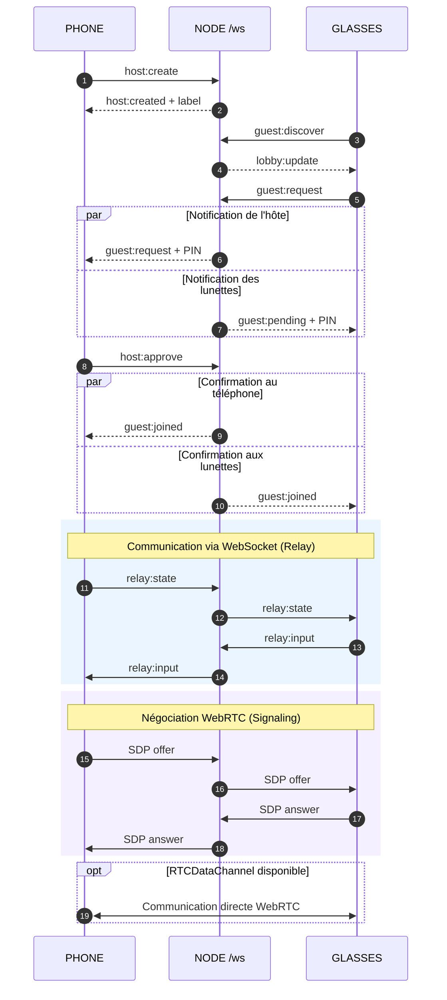

# NEON PONG // DUO — Multiplayer architecture (v1.1.8)

## Goals
- One URL, one webapp, two roles (phone host and Meta Ray-Ban Display guest).
- Zero QR scanning and no typed pairing code during normal use.
- Phone-side explicit admission, anonymous server lobby for discovery.
- WebRTC DataChannel preferred with immediate WebSocket gameplay fallback.
- Authoritative Pong ball/score physics on phone; smooth client-side guest-paddle prediction.

## Signaling lifecycle

If there is exactly one waiting match, the glasses webapp requests it automatically. If there are several, the player chooses the match label visible on their phone. Every request needs **host confirmation**; both endpoints display the same four digits for checking. Discovery matches **instances of this app on the same backend**, not necessarily the user's already-paired phone.

The lobby is ephemeral and unauthenticated, so it is appropriate for a controlled private deployment or development test. For public deployment, implement identity/authenticity, account or established pairing token, and server-side abuse protection before advertising sessions widely.

## Transport lifecycle

1. Before approval, WS carries discovery, pending requests and authorization messages only.
2. After approval, WS carries `relay` packet frames immediately, so players can begin without WebRTC support.
3. Host attempts SDP/ICE negotiation in background if RTCPeerConnection exists.
4. Each endpoint independently switches outgoing gameplay packets to RTCDataChannel when open.
5. If RTCDataChannel fails/closes, endpoint returns outgoing packets to WS. Receiver accepts validated game packets from either transport. State `seq` rejects stale out-of-order snapshots.
6. WS is required to maintain the shared room. On WS disconnection, match leaves session. Server supports one host + one approved guest per room.

## Display and input
- True-black DOM playfield; Meta Ray-Ban Display target 600×600. HTML/CSS paddles and ball use positions expressed relative to the 800×480 logical field; no WebGL requirement.
- Phone touch drag is an absolute Y position; glasses pointer-drag is a relative delta; ArrowUp/ArrowDown fallback.
- No assumption that browser JS exposes a paired phone ID or raw Neural Band volume gesture.

## Required QA
- Node engine unit tests.
- Client tests where WebRTC is **missing** and WS relay still transmits inputs/states.
- End-to-end WS signaling: host listing, discover auto, confirmation, deny/timeout, relay message validation, second guest refusal, leave/rejoin.
- Full `npm run build` and device tests on Meta Ray-Ban Display firmware before describing it as production-ready.
